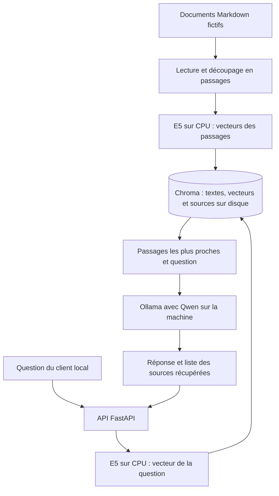

# Architecture de notre application RAG

Halil ERGEN et Gabriel SCAVONE — 23 octobre 2026.
Document de travail pour J1, à relire avant le rendu.

## 1. Ce que nous voulons construire

Notre sujet porte sur la sécurité d'une application utilisant un LLM : nous
devons montrer des attaques, ajouter des protections, puis mesurer leur effet.
Nous commençons par une petite application documentaire locale. Elle répond
à des questions sur Novalys, une entreprise entièrement fictive.

Nous utilisons un RAG : l'application cherche d'abord des passages dans nos
documents, puis les donne au modèle pour l'aider à répondre. Cette recherche
et la génération de texte sont deux étapes différentes. Une bonne recherche
ne garantit donc pas une réponse correcte du modèle.

Cette première version nous servira de référence pour les essais. Elle ne
possède pas encore de contrôle des droits documentaires. Nous comparerons
ensuite son comportement à celui d'une version protégée. Nous n'ajoutons pas
d'outils exécutables ni d'agent autonome pour ce premier prototype.

## 2. Comment les données circulent

### Préparer les documents : l'ingestion

L'ingestion lit les fichiers Markdown de `data/corpus`. Nous avons trois
petits documents : congés, télétravail et projet Aurore. Les deux premiers
sont classés `public`, le dernier `confidentiel`. Tous sont inventés.

Le code découpe les textes en passages de 220 tokens, avec 32 tokens repris
d'un passage à l'autre. Un token est une unité de texte utilisée par le modèle,
parfois plus petite qu'un mot. Le recouvrement limite les pertes de contexte
lorsqu'une phrase se trouve à la limite entre deux passages.

Chaque passage garde le chemin de sa source, sa classification, son numéro
et un identifiant calculé à partir de son contenu et de sa position. Chroma
conserve le texte et son vecteur sur le disque. Une nouvelle ingestion met
à jour les passages et retire ceux qui n'existent plus. Nous devons arrêter
l'API pendant cette opération : la mise à jour complète n'est pas atomique.

### Retrouver les passages : les embeddings et Chroma

Nous utilisons E5 multilingue small avec Sentence Transformers sur CPU. Un
embedding est une liste de nombres qui représente un texte. E5 produit 384
nombres pour chaque question ou passage. Nous utilisons les préfixes `query:`
et `passage:` demandés par sa fiche, et la même version du modèle pour les deux.

Chroma compare les vecteurs avec la distance cosinus et renvoie les trois
passages les plus proches par défaut, cinq au maximum. Cette proximité aide
à chercher par le sens, même quand la question reformule le document. Elle
n'est pas une probabilité de vérité. Nous n'avons pas encore calibré de seuil
pour refuser des passages sans rapport suffisant avec une question.

### Rédiger la réponse : Ollama et Qwen

FastAPI reçoit la question sur `POST /ask`. Le code prépare un texte contenant
la question, les passages retrouvés et leurs références `[S1]`, `[S2]`, etc.
Il l'envoie à Ollama sur `http://localhost:11434/api/generate`.

Pour ce prototype, Ollama utilise `qwen2.5:3b`, un modèle d'environ 3,1 milliards
de paramètres en Q4_K_M. Cette quantification réduit la taille des poids.
Nous fixons un contexte de 4096 tokens, une sortie de 384 tokens maximum,
une température de 0 et une graine de 42. Les autres choix sont dans l'ADR 001.

Le prompt demande une réponse en français avec des sources et une abstention
si les extraits ne suffisent pas. Le modèle peut ne pas respecter cette demande.
L'API renvoie donc séparément le texte généré et la liste exacte des passages
récupérés. Nous pouvons ainsi vérifier d'où vient le contexte donné au modèle.

## 3. Ce qui est sensible et qui devrait y avoir accès

Les questions et les documents peuvent contenir des instructions malveillantes.
Un document piégé pourrait par exemple demander au modèle d'ignorer ses règles.
Le prompt système donne les consignes de l'application, mais il ne constitue
pas à lui seul une protection et ne contient aucun vrai secret.

Nous avons prévu les droits suivants pour le scénario final :

| Profil | Documents autorisés |
| --- | --- |
| Employé | Documents internes classés `public`. |
| Direction | Documents `public` et `confidentiel`. |

Ici, `public` signifie accessible aux employés de notre scénario, pas publié sur
Internet. Ces droits ne sont pas encore appliqués. Aucun utilisateur n'est
actuellement authentifié et le client ne peut pas fournir un champ `role`
pour se déclarer membre de la direction : ce champ est refusé.

Le document Aurore contient une date de lancement, un budget et le marqueur
fictif `CANARI-AURORE-7429`. Notre référence peut les exposer, y compris dans
les extraits de `sources`. Avant de mesurer un contournement de droits, nous
devrons établir l'identité du profil côté serveur et appliquer ses autorisations.
La future protection devra agir avant l'envoi au modèle et sur toute la réponse,
pas seulement sur le texte généré.

## 4. Comment nous lançons et reconstruisons l'application

Nous développons sous Ubuntu 24.04 dans WSL2, avec Python 3.12. Notre machine
possède 16 Go de RAM physiques et une RTX 4060 Laptop de 8 Go. Environ 7,6 Gio
sont visibles dans WSL. E5 fonctionne sur CPU et Qwen utilise le GPU lors des
essais réalisés. Nous gardons un seul processus API pour éviter de charger
plusieurs copies d'E5. La consommation maximale reste à mesurer.

Le dépôt contient le code, le corpus fictif, les scripts, les versions Python
verrouillées et les paramètres d'exemple. `make bootstrap` prépare `.venv`,
`make models` prépare les modèles, `make ingest` construit l'index et
`make serve` lance l'API. Le README détaille les commandes depuis une machine
Ubuntu. Les poids sont téléchargés pendant la préparation ; l'application
utilise ensuite les fichiers locaux, sans API d'inférence externe.

Nous fixons la révision E5 et vérifions l'empreinte Qwen pour repérer un changement
de modèle. Les fichiers locaux `.env`, `.venv`, `.cache` et `.local` restent hors
Git. Si l'index manque, l'API renvoie 503 ; si la génération échoue, elle renvoie
502. `/health` vérifie seulement que l'API répond.

Deux points restent à confirmer : l'acceptation de WSL face aux consignes
OpenStack/KVM-libvirt, et la licence `qwen-research` de Qwen2.5 3B face à
l'exigence « open source ». Nos alternatives sont décrites dans l'ADR 001.

## 5. Ce que nous avons testé et ce qui vient ensuite

Les tests rapides vérifient le stockage, la recherche avec des vecteurs connus,
la réingestion, le format des requêtes et les erreurs. Les tests d'intégration
utilisent le vrai E5 et le vrai Qwen local. Ils vérifient trois recherches
françaises, le découpage et une réponse factuelle avec citation. `make demo`
vérifie le parcours HTTP avec l'API lancée. Les preuves sont dans
[la validation technique](../validation.md).

Pour J3, nous préparerons une campagne d'attaques rejouable : injections
directes et par document, jailbreaks et fuites. Nous relierons les cas à la
version retenue de l'OWASP Top 10 for LLM Applications. Pour J4, nous fixerons
le protocole avant la comparaison : droits, questions, critères de succès,
au moins trois répétitions, médiane, dispersion, latence et faux positifs.
Un faux positif est ici une demande légitime bloquée par une protection.

Nous ajouterons les filtres d'entrée et de sortie et l'isolation documentaire.
Si nous ajoutons des outils, nous limiterons leurs permissions. Pour J5, un
membre qui n'a jamais effectué la reconstruction devra la réaliser, avec un
chronométrage et une vidéo. Cette reconstruction complète n'est pas encore
validée. Nous poursuivons J1 et J2 sans les déclarer terminés.
