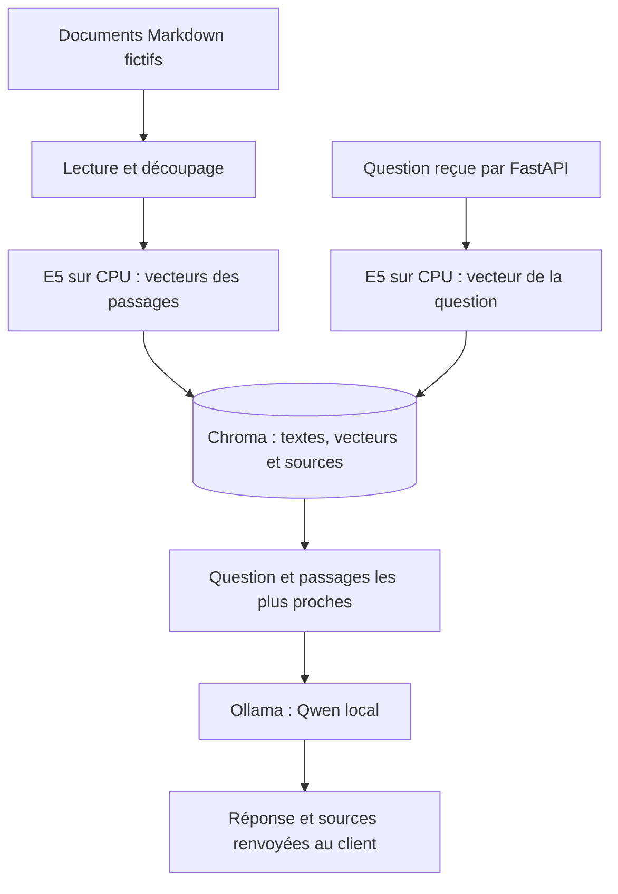

# Architecture de notre application RAG

Halil ERGEN et Gabriel SCAVONE

## 1. Notre objectif et le parcours des données

Notre sujet est la sécurité d'une application LLM : nous allons montrer des
attaques, ajouter des protections, puis comparer les résultats. Nous commençons
par un assistant qui répond à des questions sur Novalys, une entreprise fictive.
Toutes les données sont inventées. Aucun outil exécutable ni agent autonome
n'est nécessaire dans cette première version.

Nous utilisons un RAG : l'application cherche des passages dans nos documents,
puis les donne au modèle pour rédiger une réponse. La recherche et la génération
sont deux étapes distinctes. Retrouver le bon document ne garantit pas que le
modèle répondra correctement.

L'ingestion lit les fichiers de `data/corpus` : congés et télétravail dans
`public`, projet Aurore dans `confidentiel`. Elle découpe les textes en passages
de 220 tokens, avec un recouvrement de 32 tokens. Un token est une unité de
texte utilisée par le modèle ; le recouvrement reprend la fin du passage
précédent pour limiter les coupures de contexte.

Chaque passage garde son texte, sa source, sa classification, son numéro et un
identifiant calculé à partir du contenu et de sa position. Chroma conserve ces
informations et les vecteurs sur disque. Une nouvelle ingestion met à jour les
passages et retire ceux devenus obsolètes. Nous arrêtons l'API pendant cette
opération, car la mise à jour du corpus entier n'est pas atomique.

<!-- pagebreak -->

## 2. Nos composants et les limites de sécurité

E5 multilingue small transforme les textes en vecteurs de 384 nombres. Nous
utilisons les préfixes `passage:` pour les documents et `query:` pour les
questions, avec la même version du modèle. Le calcul se fait sur CPU afin de
laisser le GPU à la génération. Chroma compare les vecteurs par distance cosinus
et renvoie trois passages par défaut, cinq au maximum. Une distance faible
signale une proximité ; elle ne prouve pas qu'un passage permet de répondre.
Aucun seuil de pertinence n'est encore calibré.

FastAPI reçoit la question sur `POST /ask`. Le code assemble les passages avec
les références `[S1]`, `[S2]`, etc. et appelle Ollama à l'adresse locale
`http://localhost:11434/api/generate`. Le générateur du prototype est
`qwen2.5:3b`, environ 3,1 milliards de paramètres, quantifié en Q4_K_M pour
réduire la taille des poids. Le contexte est limité à 4096 tokens et la sortie
à 384 tokens. La température vaut 0 et la graine vaut 42. Ces réglages facilitent
les comparaisons sans garantir des réponses identiques sur tout matériel.

Le prompt demande une réponse française fondée sur les extraits, avec citations
et abstention si nécessaire. Le modèle peut ne pas respecter cette consigne.
L'API renvoie séparément le texte généré et les extraits réellement récupérés.
La présence d'une source ne suffit donc pas à prouver chaque affirmation.

Les questions et documents sont non fiables : ils peuvent contenir des
instructions destinées à détourner le modèle. Le prompt système ne contient
aucun vrai secret et ne constitue pas à lui seul une protection.

Nos droits cibles sont simples : un employé peut consulter les documents
`public` internes ; la direction peut consulter les documents `public` et
`confidentiel`. Ici, « public » ne signifie pas publié sur Internet.

Ces droits ne sont pas encore appliqués. Aucun utilisateur n'est authentifié.
Le champ `role` fourni par le client est refusé : il ne doit pas servir à se
déclarer membre de la direction. Notre référence peut consulter tout le corpus,
y compris le budget et le marqueur fictif `CANARI-AURORE-7429` d'Aurore.

Une fuite peut se produire dans la réponse du modèle, mais aussi dans les
extraits JSON renvoyés au client. La future protection devra établir l'identité
côté serveur, filtrer les documents avant envoi au modèle et contrôler toute
la sortie. Une simple étiquette de dossier ne protège rien.

<!-- pagebreak -->

## 3. Déploiement, validation et suite du projet

Nous développons sous Ubuntu 24.04 dans WSL2, avec Python 3.12. Notre machine
possède 16 Go de RAM physiques et une RTX 4060 Laptop de 8 Go. Environ 7,6 Gio
sont visibles dans WSL. Les essais du 23 octobre utilisent E5 sur CPU et Qwen
sur GPU. Nous gardons un seul processus API pour éviter de charger plusieurs
copies d'E5. Les pics de consommation restent à mesurer.

Le dépôt contient le code, le corpus fictif, les scripts, les versions Python
verrouillées et les paramètres d'exemple. `make bootstrap` prépare Python,
`make models` prépare les modèles, `make ingest` construit l'index et
`make serve` lance l'API sur `127.0.0.1:8000`. Le README décrit les étapes.
Les téléchargements initiaux nécessitent Internet ; l'application utilise
ensuite les modèles locaux, sans service d'inférence externe ni API payante.

La révision E5 est fixée et l'empreinte Qwen est vérifiée pendant la préparation.
`.env`, `.venv`, `.cache` et `.local` restent hors Git. Un index absent produit
une erreur HTTP 503 ; un échec de génération remonte en 502. `/health` indique
uniquement que l'API répond. L'index doit être reconstruit si le modèle
d'embeddings ou le découpage change.

Deux choix restent ouverts : l'acceptation de WSL comme socle final face aux
consignes OpenStack/KVM-libvirt, et la licence `qwen-research` du modèle 3B face
à l'exigence « open source ». L'ADR 001 prévoit des alternatives : VM Ubuntu,
exécution CPU ou autre serveur local, et modèle sous licence permissive à tester.
L'ADR 002 compare la recherche choisie à MiniLM et BM25, avec un index NumPy
comme solution de secours si Chroma pose problème.

Les preuves du 23 octobre indiquent 30 tests rapides et 5 tests réels réussis.
Les premiers vérifient stockage, classement, réingestion et erreurs avec des
vecteurs connus et des réponses simulées. Les seconds utilisent E5 et Qwen
locaux pour trois recherches françaises, le découpage et une réponse avec
citation. `make demo` vérifie le parcours HTTP. Ce résultat limité ne valide
ni la qualité générale du modèle ni sa résistance aux attaques.

Pour J2, nous devons consolider et rejouer la reconstruction par script. Pour
J3, nous préparerons une campagne rejouable d'injections directes et indirectes,
de jailbreaks et de fuites, reliée à l'OWASP Top 10 for LLM Applications.
Pour J4, nous fixerons le protocole avant les essais : droits, questions,
critères de succès, au moins trois répétitions, médiane, dispersion, latence
et faux positifs. Un faux positif est une demande légitime bloquée.

Les protections prévues sont le filtrage d'entrée et de sortie et l'isolation
documentaire. Si des outils sont ajoutés, leurs permissions seront limitées.
Pour J5, un membre n'ayant jamais fait la reconstruction devra la réaliser,
avec chronométrage et vidéo. Cette reconstruction complète reste à valider.
Le détail des preuves figure dans `docs/validation.md` et le calendrier dans
`docs/plan-travail.md`.
